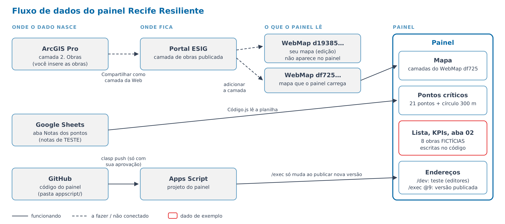

# 8. Painel

## Resumo: o que o painel entrega (15/10/2026)
Um mapa único da RPA 6 que mostra, lado a lado, **onde o risco de alagamento é maior** e
**o que já está sendo feito ali**, para orientar a prevenção priorizada por risco entre os órgãos
(COP, EMLURB, Defesa Civil, URB, CTTU, Compesa, ProMorar, SEPLAG).

- **Pontos críticos priorizados:** os 21 trechos da EMLURB no mapa, com cor pelo índice de risco
  (0–1), círculo de 300 m (área do score) e lista ordenada do maior para o menor risco. Cada ponto
  abre um cartão com as notas por dimensão (Probabilidade, Exposição, Vulnerabilidade, Impacto) e
  por variável.
- **Indicadores:** pontos críticos, pontos de risco alto (risco ≥ 9) e pontos com local a conferir;
  investimento total, obras concluídas e bairros com obras.
- **Obras de drenagem:** as obras da aba "Obras" da planilha, com ícone por tipo no mapa e a área
  desenhada no ArcGIS; lista com filtros por bacia, sub-bacia e status, e ficha de cada obra com
  dados e macroetapas (aba 03).
- **Contexto territorial:** as camadas do WebMap "Recife Resiliente v2" (rios, bacias e demais
  camadas), com legenda e liga/desliga, mapa base e Street View.
- **Uma fonte só:** o painel lê a planilha Google da equipe; quem atualiza a planilha atualiza o painel.

**Limites atuais:** as notas dos pontos são de **teste** (`RANDBETWEEN`), então o ranking ainda não
vale para decisão; 11 pontos têm coordenada aproximada; as obras ainda não têm andamento físico,
prazos nem medições (aba 02 sem dados de acompanhamento); infraestrutura crítica (hospitais,
aeroporto, metrô) ainda fora do mapa (pendência 18).

## Base (decidido por Pedro em 02/10/2026)
O painel em Google Apps Script já existente é a base. Muita coisa vai mudar.

- Código: pasta `appscript/` (cópia baixada com `clasp`, projeto
  `1Om9PIGQQrIXZ9cTFqbv_iLv9DIvyGW3AbJEDejtEU2SC9PbKDbUVuIFr`).
- Web app (`doGet`) com ArcGIS Maps SDK 4.29, que carrega um WebMap do portal
  ESIG (`esigportal2.recife.pe.gov.br`). Desde 05/10/2026, item `d19385d68f1b4303b5f94ddc5ce58ff6`
  ("Recife Resiliente v2", publicado por Pedro; antes `df725ec964b840a1afbc348ae4555c20`).
- Abas atuais: 01 Panorama · 02 Físico-Financeiro · 03 Ficha do Ponto.
- Até 05/10/2026 os dados de obras eram ilustrativos (8 obras fictícias), escritos no código.

## Fluxo de dados

Gerado por `scripts/gerar_fluxo_painel.py` (06/10/2026). Tracejado = a fazer ou
não conectado.

## Decisões
| Tema | Decisão |
|---|---|
| Obras fictícias | Substituídas em 05/10/2026 pelas obras reais da camada de obras do WebMap |
| Notas pelo Google Sheets | Ainda não |
| Acesso ao painel | A definir |
| Pontos críticos | Pedro vai subir um mapa novo no ArcGIS com os pontos |
| Pontos críticos no painel | Teste: o painel lê a aba "Notas dos pontos" da planilha Google Sheets `1DN3abWIPk0dvOkh-28D2NGYBLgMI437Vx7Sk7TqpDc0` e mostra os pontos com popup |
| Rede hidrográfica | Removida do código (`HidroData.html`); virá das camadas do ArcGIS |

## Implantações
- **Teste (HEAD, sempre o código mais recente):**
  https://script.google.com/macros/s/AKfycbwHvKBxXuhdg200oKKwCvdF4uZPHBWsiEE9kTqK5TI/dev
  (só abre para quem é editor do projeto).
- Versões publicadas: 9 implantações; a mais recente é a @9 "Primeira versão
  que deu certo". O `clasp push` não altera nenhuma delas.
- 02/10/2026: primeiro `clasp push` (pontos críticos lidos da planilha,
  sem HidroData).
- 03/10/2026: `clasp push` com as variáveis de 03/10 (nomes novos; I3, V5
  e V6) e a função única `atualizarSubcriterios0310`, executada por Pedro no
  editor. Aba "Notas dos pontos" conferida: 7 cabeçalhos renomeados, V5 e V6
  antes do V1, I3 antes do I2 (ordem I1, I3, I2), colunas novas sem nota e
  sem peso, "Notas preenchidas" = 15 nos 21 pontos, risco calculado nos 21.
  Fórmulas escritas por script não usam separador de argumentos (planilha em
  pt-BR usa `;`).
- 03/10/2026: o cartão do ponto passa a mostrar o nome de cada variável
  como está no cabeçalho da planilha. Para renomear, basta mudar o texto
  depois do código (ex.: `V5` + quebra de linha + novo nome); **não mudar o
  código**. A função `atualizarSubcriterios0310` foi removida.
- 03/10/2026: `clasp push` com o branch do painel (gota com onda, círculo
  de 300 m) juntado ao das variáveis. O push anterior do mesmo dia tinha
  ido sem esses commits.
- 03/10/2026: painel conferido por Pedro (gota, círculo de 300 m, nomes no
  cartão). Novo `clasp push` com os termos novos: o cartão mostra
  "Dimensão / variável". Na planilha, a aba "Checklist subcritérios" passou
  a se chamar "Checklist variáveis" (o painel não lê essa aba).
- 03/10/2026: planilha renomeada para "Recife_Resiliente_Checklist_Variaveis"
  (o link não muda). Abas "Checklist variáveis" e "Glossário" reescritas com o
  conteúdo do `.xlsx` atual (18 variáveis, termos novos); as fórmulas do
  resumo foram mantidas e se ajustaram às linhas novas (N5:N22).
- 03/10/2026: coluna "Fonte de medição" (E) criada na aba "Checklist
  variáveis", ao lado de "Como medir", vazia (a preencher). As colunas a
  preencher passaram a ser O, P e Q; fórmulas e listas se ajustaram.

- 05/10/2026 (`clasp push` feito com aprovação de Pedro): WebMap trocado para "Recife Resiliente v2";
  a lista "Legenda e Camadas" mostra os grupos do WebMap (▸ abre as camadas de dentro)
  e segue a ordem do Conteúdo do ArcGIS (camada de cima primeiro).

- 05/10/2026: restauradas 346 regras de estilo (lista de camadas, mapa base, controles do mapa, aviso do
  Google Maps, abas 02 e 03) que tinham sido apagadas por engano no commit 2982a35 (02/10). Ficam antes
  das regras atuais, que prevalecem em caso de conflito.

- 05/10/2026: nova legenda "Camadas": amostra do símbolo real de cada camada (inclui hachuras do
  ArcGIS Pro), classes de cada camada (ex.: tipos de via), olho para mostrar/ocultar, grupos recolhíveis,
  nomes sem a numeração do Conteúdo e painel que recolhe no título.

- 05/10/2026: lista, KPIs, filtros e ficha passam a usar as **obras reais** da camada de obras do
  WebMap (camada cujo nome contém "obra"; campos obra, nome, bairro, bacia, status, invest, orgao, fonte;
  polígonos com o mesmo número viram uma obra só). Andamento, prazos, empresa e entraves não existem na
  base: aparecem como "a informar"; a aba 02 mostra aviso de "sem dados de acompanhamento" e a ficha
  (aba 03) mostra só os dados da camada. KPI "Pontos mitigados" virou "Obras concluídas".

- 05/10/2026: `clasp push` das obras reais. Criada a aba **"Obras"** na planilha do painel (25 colunas:
  identificação, situação, valores, prazos, % físico, escopo, entraves, fonte_info), com a obra 1
  (Canal do Sanbra) preenchida a partir da camada e a obra 2 em branco. O painel **ainda não lê** essa aba
  (próximo passo: ligar pela `obra_id`, com a planilha mandando nos dados e o mapa só no desenho).
- 05/10/2026: criada a aba **"Cronograma das obras"** (uma linha por macroetapa: obra_id, ordem,
  macroetapa, início e término previstos e reais, % concluído, caminho crítico, responsável,
  observações), com 11 linhas para cada obra (1 e 2). Nome da macroetapa, datas e % em branco, para
  preenchimento livre (decisão de Pedro, 05/10). Vai alimentar o Gantt da ficha (aba 03).

- 05/10/2026 (código; push após aprovação): o painel lê as abas "Obras" e "Cronograma das obras"
  (`getObras()` em `Código.js`) e junta com o desenho da camada de obras pelo `obra_id`. A planilha
  manda nos dados; obra só na planilha aparece como "sem desenho no mapa". A ficha (aba 03) mostra todos
  os campos da aba "Obras" e o Gantt das macroetapas (previsto, realizado, atrasado, caminho crítico).
  A aba 02 continua com o aviso até ser adaptada aos dados reais.

- 05/10/2026: lista de intervenções mostra **só as obras da aba "Obras"** (decisão de Pedro). Polígono
  do mapa sem linha na planilha fica de fora; se a planilha não puder ser lida, a lista avisa.

- 07/10/2026 (`clasp push` com aprovação de Pedro): **lista de cartões dos pontos críticos à
  direita do mapa**, no estilo da lista de intervenções: ordem do ranking, posição, índice de risco
  (cor na borda), trecho, bairro · tipo e aviso "Local aproximado". Clicar no cartão aproxima o mapa
  e abre o cartão do ponto; clicar no ponto do mapa marca o cartão na lista. A busca do topo também
  filtra a lista (trecho ou bairro). Botões de zoom e legenda passaram para a esquerda da lista.

- 07/10/2026 (`clasp push` com aprovação de Pedro): **pontos das obras com ícone por tipo**. O painel lê a
  coluna "coordenadas (lat, lon)" da aba "Obras" e desenha cada obra na camada "Obras (pontos da
  planilha)", com o ícone do tipo (canal, dragagem, reservatório, dique, parque alagável, rede;
  vazado quando em licitação; cone genérico quando o tipo está vazio). Coordenada vazia, ilegível ou
  fora do Recife não desenha ponto. Clicar no ponto seleciona a obra na lista; os filtros e a busca
  valem também para os pontos. A coordenada passa a ser o centro do zoom ao selecionar a obra.
  Ícones embutidos no código com `python3 scripts/gerar_icones_obras_tipo.py --js`.

- 14/10/2026 (`clasp push` feito com aprovação de Pedro): **indicadores dos pontos críticos** no
  topo da aba 01, ao lado dos de obras e separados por um traço: "Pontos críticos" (21), "Risco alto"
  (risco ≥ 9, o corte 3 × 3 da matriz em `02-metodologia-hierarquizacao.md`) e "Local a conferir"
  (coordenada aproximada ou ausente). Seguem a busca do topo. "Risco alto" leva a etiqueta
  "notas de teste" enquanto a planilha usar `RANDBETWEEN`; tirar a etiqueta quando entrarem as notas reais.

- 14/10/2026 (`clasp push` feito com aprovação de Pedro), pedidos de Pedro:
  - **Ícones maiores.** Gota do ponto crítico: de 14–26 pt para 20–34 pt (o tamanho ainda cresce com o
    índice). Ícones de obra: os marcadores de ponto das camadas do WebMap com "obra" no nome ficam 1,6 vez
    maiores (`ESCALA_ICONE_OBRA`). Áreas e linhas não mudam. Não testado: depende de como o símbolo foi
    publicado no WebMap.
    **Retirado no mesmo dia:** com a troca do renderer, os pontos das obras sumiram do mapa. A camada de
    obras volta a usar o símbolo do WebMap sem mudança; para aumentar, mudar o tamanho no próprio WebMap.
  - **Lista de pontos críticos recolhível.** Botão ▴ no título da lista; recolhida, fica só o título.
  - **Anel de criticidade.** Camada nova "Grau de criticidade (índice de risco)": anel em volta de cada
    ponto, na cor da classe do índice (verde < 0,200; amarelo 0,200–0,333; laranja 0,333–0,500;
    vermelho ≥ 0,500, as mesmas classes de `CLASSES_INDICE`). Liga e desliga na legenda. Com as notas de
    teste, as cores mudam a cada recálculo da planilha.
  - Ajuste no mesmo dia (Pedro preferiu o círculo em volta da figura; `clasp push` feito com aprovação): o anel saiu da camada separada e
    passou a fazer parte do próprio ícone (borda de 3 px na cor da classe, colada na gota). A camada
    "Grau de criticidade" foi removida; a legenda dos pontos mostra os 4 ícones. Gota de 22 a 38 pt.
  - Segundo ajuste (pedido de Pedro; `clasp push` feito com aprovação, junto com a retirada do aumento dos ícones de obra): **raio de 300 m na cor da prioridade** (contorno tracejado e
    preenchimento claro na cor da classe do índice), com botão **"Raio 300 m"** no título da lista de pontos
    para ligar e desligar (sincronizado com o olho da legenda). Cores mais fortes: amarelo `#f2b705` e
    laranja `#f46d43` no lugar de `#fee08b` e `#fc8d59` (verde e vermelho iguais). Anel do ícone mais
    largo (5 de 32), com contorno branco.

- 14/10/2026: o `clasp push` das 18:45 sobrescreveu os pontos das obras de 07/10 (o commit estava só no
  branch `claude/nifty-curie-ozwq8s`, fora do `main`). O branch foi juntado de volta e os pontos voltaram.
  Antes de cada `clasp push`, conferir se o branch tem tudo o que já foi enviado.
- 14/10/2026: ícones da camada "Obras (pontos da planilha)" de 26 para 36 px (pedido de Pedro de ícones
  de obra maiores).
- 15/10/2026 (`clasp push` feito com aprovação de Pedro): os ícones das obras da planilha não apareciam
  no painel, porque o merge que os trazia de volta (`ca023d6`) não tinha sido enviado. Enviado a partir do
  branch `claude/dreamy-shannon-ycw0nv` (main + `claude/inspiring-carson-nu2f7a`), com PR para o `main`.
- 15/10/2026 (`clasp push` feito com aprovação de Pedro): ícones das obras desenhados **acima** dos pontos
  críticos e do raio de 300 m (camada "Obras (pontos da planilha)" adicionada por último ao mapa).
  Não bastou: o WebMap põe as camadas dele por cima depois de carregar (os rios cobriam as obras).
- 15/10/2026 (`clasp push` feito com aprovação de Pedro): depois que o WebMap carrega, as camadas do painel
  voltam ao topo (`map.reorder`), de baixo para cima: raio de 300 m, pontos críticos, obras.

## Estado em 02/10/2026 (aprovado por Pedro)
- Paleta: #0869A6 · #2685BF · #5496BF · #FFFFFF · #F2F2F2 (painel inteiro).
- Pontos críticos lidos da planilha Google Sheets, cor pelo índice de risco.
- Cartão do ponto (no lugar do popup do ArcGIS): abre à direita do ponto,
  centralizado na altura dele, a 36 px; estilo da ficha do Plano de Ações
  de SP; sem número do ponto; nível de risco em palavras; tabela dimensão/
  variável × avaliação; botões Aproximar e Street View.

## Em aberto
- Cores do nível de risco: manter verde/amarelo/laranja/vermelho ou usar
  tons de azul.
- Liberar `*.arcgis.com` e `esigportal2.recife.pe.gov.br` na rede do
  ambiente para testar o painel antes de cada envio.

## Como trabalhar no código
1. Editar os arquivos em `appscript/`; cada mudança vira um commit.
2. Enviar ao Apps Script com `clasp push` **só depois da aprovação de Pedro**.
3. Testar pela URL de teste (Implantar → Testar implantações); o link
   publicado só muda quando Pedro publicar uma nova versão.

## Camadas para o ArcGIS (`dados/processados/arcgis/`)
- Pontos: usar `dados/processados/pontos_rpa6.geojson` / `.csv` (os 21 pontos,
  com lat/lon e UTM). A cópia `pontos_criticos_rpa6` foi removida em 04/10/2026.
- `buffer_300m_rpa6.geojson` e `buffer_1000m_rpa6.geojson`: círculos.
- Coordenadas ainda aproximadas.

## Pontos de atenção do painel atual
- A "Matriz de risco" da aba 02 é atraso × severidade das obras, não
  Probabilidade × Consequência. Renomear ou separar quando o risco entrar.
- `access: ANYONE`: se o WebMap do ESIG exigir login, quem não tiver acesso
  pode ver o mapa vazio (não testado).
- `GOOGLE_MAPS_EMBED_KEY` vazio: Street View e modo Google Maps mostram aviso.

- 15/10/2026: coluna **AJ "Obras relacionadas (obra_id)"** criada na aba "Notas dos pontos" (depois de
  "Notas preenchidas"), vazia, para Pedro informar os `obra_id` da aba "Obras" ligados a cada ponto,
  separados por ponto e vírgula (ex.: `1; 13`). Formato texto. O painel ainda não lê a coluna (próximo
  passo: linha ponto ↔ obra no mapa, "Obras relacionadas" no cartão do ponto e pontos na ficha da obra).
  A coluna "pontos_criticos (ids)" da aba "Obras" fica sem uso, para não haver duas fontes da mesma ligação.
- 15/10/2026: Pedro ligou a obra 2 (Canal da Mauricéa) aos pontos 9 e 36 (Av. Mascarenhas de Moraes) e
  24 (Rua Blumenau). O painel passa a ler a coluna "Obras relacionadas": camada "Ligação pontos críticos ↔
  obras" (linha tracejada do ponto ao ícone da obra; liga e desliga na legenda), seção "Obras
  relacionadas" no cartão do ponto (clique abre a ficha da obra) e "Pontos críticos relacionados" na
  ficha da obra (aba 03), no lugar da coluna "pontos_criticos (ids)" da aba "Obras". Obra sem
  coordenada na aba "Obras" não ganha linha. `clasp push` feito com aprovação de Pedro (15:32).
- 15/10/2026: as linhas de ligação só aparecem para o ponto clicado (cartão aberto); fechar o cartão apaga as linhas. `clasp push` feito com aprovação de Pedro (15:38).
- 15/10/2026: **animação ao clicar no ponto crítico** (aprovada por Pedro na prévia
  `docs/prototipos/animacao_ligacao.html`): zoom que enquadra o ponto e as obras ligadas na área livre do
  mapa (700 ms), salto da gota (450 ms), linha correndo do ponto até a obra (600 ms) e pulso na obra
  (700 ms). Ponto sem obra: zoom, salto e pulso na cor do risco. Fechar o cartão apaga as linhas e não mexe
  no zoom. Quem usa "reduzir movimento" no sistema vê tudo sem animação. `clasp push` feito com aprovação de Pedro (15:50).
- 15/10/2026 (`clasp push` feito com aprovação de Pedro): zoom do clique no ponto mais aberto (Pedro achou
  muito grande): folga de 40% em volta e no mínimo ~2 km de largura (antes ~650 m).
- 15/10/2026: lista de **Intervenções** (esquerda) também recolhe e abre, com o mesmo botão da lista de
  pontos críticos. Com a lista recolhida, o zoom do clique no ponto usa o espaço liberado. `clasp push` feito com aprovação de Pedro.
- 16/10/2026: **círculo de 300 m retirado do mapa** (pedido de Pedro), junto com o botão "Raio 300 m" e a
  camada "Área de análise — 300 m" da legenda. O raio de 300 m continua sendo a área do score. `clasp push` feito com aprovação de Pedro.
- 16/10/2026: mapa base **Original** (o do WebMap) ao abrir o painel, no lugar do Cinza. Quadros "Mapa base" e
  "Camadas" lado a lado, embaixo, entre a lista de intervenções e a de pontos críticos; a lista de camadas
  abre para cima, com rolagem (até 45% da altura). Em tela estreita continuam empilhados à direita. `clasp push` feito com aprovação de Pedro.
- 16/10/2026: legenda **Camadas na horizontal**: cada grupo do WebMap vira uma coluna (as camadas soltas
  ficam juntas na primeira), com rolagem lateral quando não cabe. Recolher a lista de intervenções ou a de
  pontos libera a faixa de baixo daquele lado para Mapa base e Camadas. `clasp push` feito com aprovação de Pedro.
- 16/10/2026: legenda dos pontos críticos com um ícone só (antes, um por classe do índice). `clasp push` feito com aprovação de Pedro.
- 16/10/2026: quadro **Mapa base** em uma linha só (título, botões, Google Maps) e recolhível pelo "–" no fim
  da linha; recolhido, fica só o título. `clasp push` feito com aprovação de Pedro.
- 16/10/2026: **ícones das obras redesenhados** para conversar com a gota do ponto crítico (prévia em
  `docs/prototipos/icones_obras_proposta.html`): hexágono com borda branca, anel e miolo, desenho branco do
  tipo. Em obra #0869A6, concluída #5496BF, em licitação vazada com anel tracejado, a informar cinza.
  Os SVG/PNG de `mapa/icones/` (para o ArcGIS) continuam no desenho antigo. `clasp push` feito com aprovação de Pedro.
- 16/10/2026 (decisão de Pedro): **6 etapas das obras** no lugar de 3 status: Não planejado, Conceitual, Em
  projeto, Em licitação, Em obra, Concluída. Ícone estilo D2 (`docs/prototipos/situacao_obras.html`): fundo
  branco, contorno e desenho na cor da etapa (cinza tracejado, roxo #A855F7, índigo #4F46E5, ciano #0EA5E9,
  azul #0869A6, grafite #1E293B). Na legenda, "Obras (pontos da planilha)" virou grupo com uma camada por
  etapa; o filtro "Status" tem as 6 etapas. Na planilha, coluna `status` da aba "Obras" com lista suspensa
  das 6 etapas (aviso, sem bloquear); "obra" → "Em obra" e "Concluído" → "Concluída" reescritos. Vazio =
  Não planejado. O painel ainda aceita textos antigos ("prevista" → Conceitual, "execução" → Em obra). `clasp push` feito com aprovação de Pedro (22:13).
- 16/10/2026: etapas "Em licitação" em rosa #DB2777 (o ciano se confundia com o azul de "Em obra") e
  "Concluída" em verde #16A34A (pedido de Pedro); ícones das obras de 36 para 44 px; controles do mapa
  (+, −, início, enquadrar, SV) na horizontal, no alto, à esquerda da lista de pontos. `clasp push` feito com aprovação de Pedro.
- 16/10/2026: **lista de pontos críticos embaixo da de intervenções**, na coluna da esquerda (cada uma com
  metade da altura; recolher uma dá a altura para a outra). A direita do mapa fica livre; controles do mapa
  e Mapa base/Camadas passam a ir até a borda direita. `clasp push` feito com aprovação de Pedro.
- 16/10/2026 (pedido de Pedro): Mapa base e controles do mapa **de volta à vertical**. Mapa base com título,
  botões e Google Maps em linhas separadas (o "–" de recolher fica no título); controles em coluna no meio da
  direita do mapa. `clasp push` feito com aprovação de Pedro.
- 16/10/2026 (pedido de Pedro): botões de mapa base (Cinza, Ruas, Satélite, Original) retirados; o painel usa
  só o mapa base Original do WebMap. O quadro passou a se chamar "Mapa" e ficou com "Ver no Google Maps". `clasp push` feito com aprovação de Pedro.
- 16/10/2026 (pedido de Pedro): quadro "Mapa" (botão "Ver no Google Maps" e aviso "i") retirado; embaixo fica só Camadas. `clasp push` feito com aprovação de Pedro.
- 16/10/2026: colunas da legenda Camadas centralizadas no quadro; **cards pintados e translúcidos**:
  intervenções na cor da etapa (a mesma do ícone), pontos críticos na cor da classe do índice de risco
  (verde, amarelo, laranja, vermelho), com a faixa da esquerda na cor cheia. `clasp push` feito com aprovação de Pedro.
- 16/10/2026: em vez do card inteiro pintado, a cor fica só nos textos-chave: o selo da etapa nas
  intervenções e o número do índice de risco nos pontos (cor escurecida 30% para ler bem; o amarelo puro não
  lê), mais uma faixa fina à esquerda. O fundo dos cards volta ao translúcido neutro. `clasp push` feito com aprovação de Pedro.
- 16/10/2026: contorno do card inteiro (2 px) na cor da etapa (intervenções) e da classe do índice (pontos), no lugar da faixa da esquerda. Contorno translúcido (45% de opacidade), pedido de Pedro. `clasp push` feito com aprovação de Pedro.
- 16/10/2026: quadro Camadas translúcido (fundo branco a 38% com desfoque) e linhas pretas (contorno, divisória do título, separação das colunas e dos grupos). `clasp push` feito com aprovação de Pedro.
